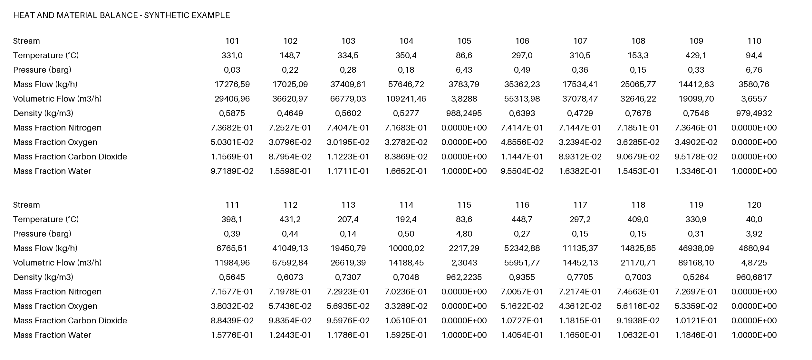
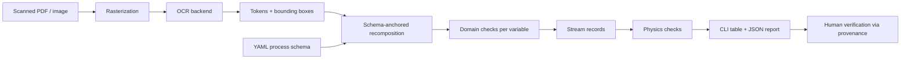

# plantdata-verify

> First module: **hmb-extract** — heat & material balance sheets. The CLI and the Python package keep the `hmb-extract` / `hmb_extract` name.

**Engineering-verified extraction for heat & material balance sheets.**

Extract process tables from scanned engineering PDFs, preserve the provenance of every value, then verify each stream with domain rules and physics — not with a hand-typed answer key.

[](https://github.com/pportilho/plantdata-verify/actions/workflows/ci.yml)
[](https://www.python.org/)
[](LICENSE)

<p align="center">
  
</p>

## Why this project exists

Industrial process data often arrives in a form that is visually readable but computationally hostile:

- the PDF has no usable text layer;
- OCR recovers characters but loses table structure;
- a wrong digit can still look plausible;
- a transcription may be internally inconsistent without looking obviously wrong;
- a hand-built answer key only validates the cells someone remembered to check.

For engineering work, **successful OCR is not the same as trustworthy data**.

`hmb-extract` treats extraction as an engineering verification problem:

> **document → OCR tokens → process structure → domain validation → physics checks → traceable result**

## What makes it different

| Layer | What it does | Failure made visible |
|---|---|---|
| OCR | Reads text and token geometry from scanned pages | missing or malformed tokens |
| Schema | Defines expected variables, units and plausible ranges | impossible values |
| Recomposition | Rebuilds streams from labels + headers + geometry | ambiguous/missing cells |
| Physics | Checks relationships independent of page layout | internally inconsistent streams |
| Provenance | Keeps bounding boxes for value, row label and stream header | every number can be checked against the source |

The core rule is simple: **geometry proposes; engineering constraints decide whether the result is believable.**

## Architecture



Two validation layers are deliberately independent:

1. **domain validation** rejects values outside the expected engineering range;
2. **physics validation** checks relationships that do not depend on where the number appeared on the page.

Current physics checks:

- density = mass flow / volumetric flow;
- mass fractions sum to 1.

See [docs/ARCHITECTURE.md](docs/ARCHITECTURE.md) for module boundaries and design decisions.

## Evidence, not just a demo

The repository ships a reproducible synthetic H&MB sheet with **20 process streams** plus real OCR output.

Validation assets:

- `examples/synthetic_hmb.pdf` — image-only test sheet;
- `examples/clean.tokens.json` — real Apple Vision OCR at 200 dpi;
- `examples/truth.json` — generated ground truth;
- `examples/faulty.tokens.json` — controlled defects that reproduce real OCR failure modes;
- automated tests for schema parsing, number parsing, recomposition, checks, CLI behavior and OCR integration;
- CI on Python 3.11 and 3.12 plus a repository leak/sanitization check.

The clean OCR reconstruction matches the generated truth for all 20 streams. The faulty dataset is designed so repairable OCR defects are repaired while physically inconsistent streams are flagged.

See [docs/VALIDATION.md](docs/VALIDATION.md) for what this proves — and what it does not prove.

## 60-second demo — no OCR required

```bash
git clone https://github.com/pportilho/plantdata-verify && cd plantdata-verify
python -m venv .venv && . .venv/bin/activate
pip install -e .
hmb-extract run examples/faulty.tokens.json --schema examples/schema.yaml
```

<!-- demo:start -->
```text
stream      T     P        m        V      rho     w_N2      w_O2     w_CO2     w_H2O  density  fractions
------  -----  ----  -------  -------  -------  -------  --------  --------  --------  -------  ---------
   101    331  0.03  17276.6    29407   0.5875  0.73682  0.050301   0.11569  0.097189       OK         OK
   102  148.7  0.22  17025.1    36621   0.4649  0.72527  0.030796  0.087954   0.15598       OK         OK
   103  334.5  0.28  37409.6    66779   0.5602  0.74047  0.030195   0.11223   0.11711       OK         OK
   104  350.4  0.18  57646.7   109241   0.5277  0.71683  0.032782  0.083869   0.16652       OK         OK
   105   86.6  6.43  3783.79        4   988.25        0         0         0         1     FAIL         OK
   106    297  0.49  35362.2    55314   0.6393  0.74147  0.048556   0.11447  0.095504       OK         OK
   107  310.5  0.36  17534.4  37078.5   0.4729  0.71447  0.032394  0.089312   0.16382       OK         OK
   108  153.3  0.15  25065.8  32646.2   0.7678  0.71851  0.036285  0.090679   0.15453       OK         OK
   109  429.1  0.33  14412.6  19099.7   0.7546  0.13646  0.034902  0.095178   0.13346       OK       FAIL
   110   94.4  6.76  3580.76   3.6557  979.493        0         0         0         1       OK         OK
   111  398.1  0.39  6765.51    11985   0.5645  0.71577  0.038032  0.088439   0.15776       OK         OK
   112  431.2  0.44  41049.1  67592.8   0.6073  0.71978  0.057436  0.098354   0.12443       OK         OK
   113  207.4  0.14  19450.8  26619.4   0.7307  0.72923  0.056935  0.095976   0.11786       OK         OK
   114  192.4   0.5    10000  14188.5   0.7048  0.70236  0.033289    0.1051   0.15925       OK         OK
   115   83.6   4.8  2217.29   2.3043  962.223        0         0         0         1       OK         OK
   116  448.7  0.27  52342.9  55951.8   0.9355  0.70057  0.051622   0.10727   0.14054       OK         OK
   117  297.2  0.15  11135.4  14452.1   0.1705  0.72174  0.043612   0.11815    0.1165     FAIL         OK
   118    409  0.15  14825.9  21170.7   0.7003  0.74563  0.056116  0.091938   0.10632       OK         OK
   119  330.9  0.31  46938.1  89168.1   0.5264  0.72697  0.053359   0.10121   0.11846       OK         OK
   120     40  3.92  4680.94   4.8725  960.682        0         0         0         1       OK         OK

streams: 20   discarded values: 0
  density    pass  18   fail   2   no data   0
  fractions  pass  19   fail   1   no data   0
```
<!-- demo:end -->

The injected faults are intentional:

| Injected fault | Result |
|---|---|
| Two cells read without a separator | split back into two cells, both values correct |
| Same, where the second cell starts with a digit | split correctly — avoids a plausible but catastrophic exponent error |
| Row label truncated by OCR (`Carbon Dioxide` → `Carbon`) | row still found through the schema label |
| Volumetric flow printed with one significant figure | **density check fails** |
| Misread digit in density | **density check fails** |
| Misread digit in a mass fraction | **fraction-sum check fails** |

The first three are repairable extraction defects. The last three remain visible because the engineering checks reject the resulting stream.

## Run it on your own sheet

```bash
pip install -e ".[ocr]"
hmb-extract run sheet.pdf --page 5 --schema my_schema.yaml -o sheet.json
```

Supported OCR paths:

- **macOS:** Apple Vision helper;
- **Linux / Windows / macOS:** Tesseract.

On macOS:

```bash
swiftc -O swift/ocr_tokens.swift -o build/ocr_tokens
hmb-extract run sheet.pdf --schema my_schema.yaml --ocr vision
```

For the included test sheet, keep 200 dpi: Vision may downsize larger images internally, and a higher rasterization DPI can reduce recognition quality.

Every accepted value in the JSON report keeps provenance for:

- the value token;
- the matched row label;
- the matched stream header.

That makes the extraction auditable by a human without re-reading the whole sheet.

### Adapt the schema

Copy `examples/schema.yaml`.

Each row defines:

- a stable code;
- the shortest distinguishing label;
- unit;
- plausible minimum/maximum.

Mass-fraction rows live under `components`. The schema also declares which values participate in independent physics checks.

## Check data from any extractor

The verification layer is independent of OCR. Feed it records produced by an LLM, spreadsheet, parser or another OCR system:

```bash
hmb-extract check records.json --schema examples/schema.yaml
```

Exit code is **1** if any configured physics check fails.

```json
{"streams": {"204": {"values": {"m": 2306.51, "V": "2,5271", "rho": 912.7,
                                "w_N2": 0.72, "w_O2": 0.05, "w_CO2": 0.10, "w_H2O": 0.13}}}}
```

Values may be numbers or text in BR (`2306,51`) or US (`2,306.51`) format. Missing data is reported as `no_data`, never as `pass`.

## Scope and limits

Current v0.1 scope is intentionally narrow:

- one H&MB sheet/page per run;
- image-only/scanned PDFs for extraction;
- row labels on the left and stream IDs as column headers;
- user-supplied engineering schema;
- density and mass-fraction consistency checks.

Out of scope today:

- generic table extraction from arbitrary layouts;
- automatic process-schema inference;
- claiming that a stream is *correct* merely because checks pass;
- replacing engineering review.

Passing checks means the available numbers are internally consistent with the configured rules. It is evidence, not proof of complete correctness.

## Development

```bash
pip install -e ".[dev]"
pytest -m "not ocr"
```

CI runs the non-OCR test suite on Python 3.11 and 3.12 and executes the repository sanitization check.

## Design notes

- [Architecture](docs/ARCHITECTURE.md)
- [Validation strategy](docs/VALIDATION.md)

MIT License.
